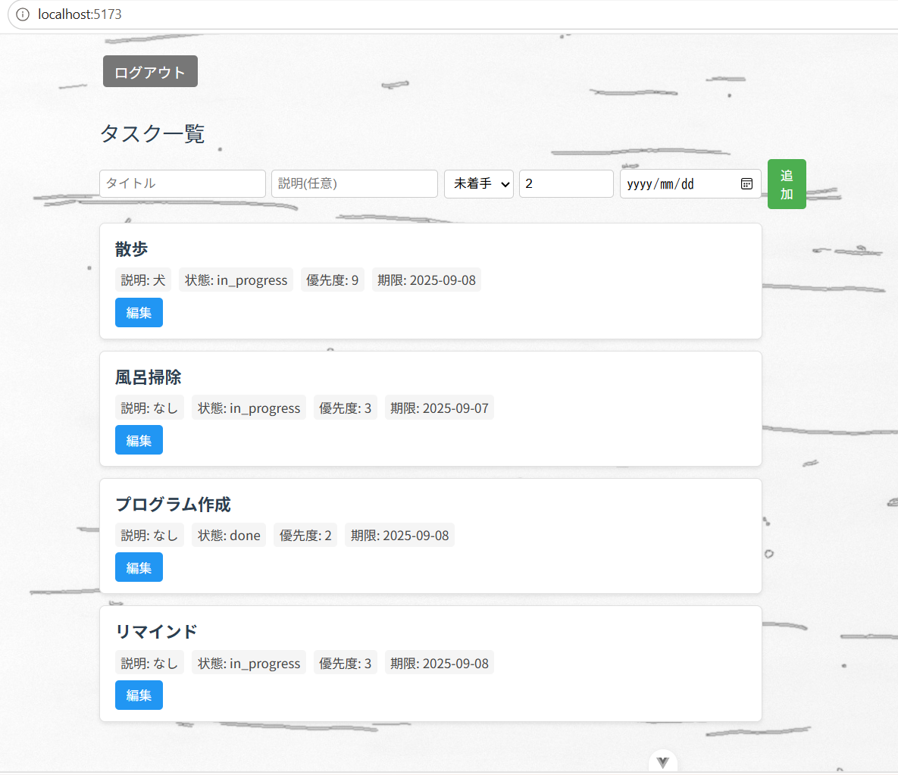

# Todo App (Vue + FastAPI)

Vue.js と FastAPI を使用したフルスタックの Todo タスク管理アプリケーションです。
ユーザー認証機能を備え、ログインしたユーザーごとにタスクを管理できます。

## デモ



## 特徴

- ユーザー登録・ログイン機能（JWT トークンによる認証）
- パスワードは bcrypt でハッシュ化して保存
- タスクの登録・一覧取得・更新（タイトル・説明・ステータス・優先度・期限を管理）
- フロントエンドとバックエンドを分離した構成（SPA + REST API）

## 技術スタック

### フロントエンド
- Vue.js 3
- Vite

### バックエンド
- Python / FastAPI
- Uvicorn
- PostgreSQL
- psycopg2
- passlib（bcrypt）によるパスワードハッシュ化
- python-jose による JWT 認証
- python-dotenv による環境変数管理

## ディレクトリ構成

```
todo_pro/
├── todo_vue/          # フロントエンド（Vue + Vite）
│   ├── src/
│   ├── public/
│   ├── index.html
│   ├── vite.config.js
│   └── package.json
├── todo_fastapi/      # バックエンド（FastAPI）
│   ├── main.py
│   ├── requirements.txt
│   └── .env.example
└── start.bat          # フロント・バックエンドを一括起動するスクリプト
```

## セットアップ手順

### 1. リポジトリのクローン

```bash
git clone <このリポジトリのURL>
cd todo_pro
```

### 2. バックエンド（FastAPI）のセットアップ

```bash
cd todo_fastapi
python -m venv venv
venv\Scripts\activate      # Windowsの場合
pip install -r requirements.txt
```

`.env.example` をコピーして `.env` を作成し、環境に合わせて値を設定してください。

```bash
copy .env.example .env
```

```
PG_PASSWORD=あなたのPostgreSQLパスワード
SECRET_KEY=JWT署名用のランダムな文字列
```

PostgreSQL に `todo` という名前のデータベースを作成し、`users` テーブル・`tasks` テーブルを用意してください。

サーバーの起動:

```bash
uvicorn main:app --reload
```

### 3. フロントエンド（Vue）のセットアップ

```bash
cd todo_vue
npm install
npm run dev
```

ブラウザで `http://localhost:5173` にアクセスすると画面が表示されます。

### 4. 一括起動（Windows）

ルートの `start.bat` を実行すると、フロントエンド・バックエンドの起動とブラウザでのアクセスをまとめて行えます。

## API エンドポイント

| メソッド | パス | 説明 | 認証 |
|---|---|---|---|
| POST | `/users/` | ユーザー登録 | 不要 |
| POST | `/login/` | ログイン（アクセストークン発行） | 不要 |
| POST | `/tasks/` | タスク登録 | 必要 |
| GET | `/tasks/` | 自分のタスク一覧取得 | 必要 |
| PUT | `/tasks/{task_id}` | タスク更新 | 必要 |

認証が必要なエンドポイントは、リクエストヘッダーに以下の形式でアクセストークンを付与してください。

```
Authorization: Bearer <access_token>
```

## 今後の課題

- タスク削除機能の実装
- 入力バリデーションの強化
- テストコードの追加
- 本番環境向けのデプロイ設定（Docker化など）

## ライセンス

このプロジェクトは学習・ポートフォリオ用途で作成しています。
